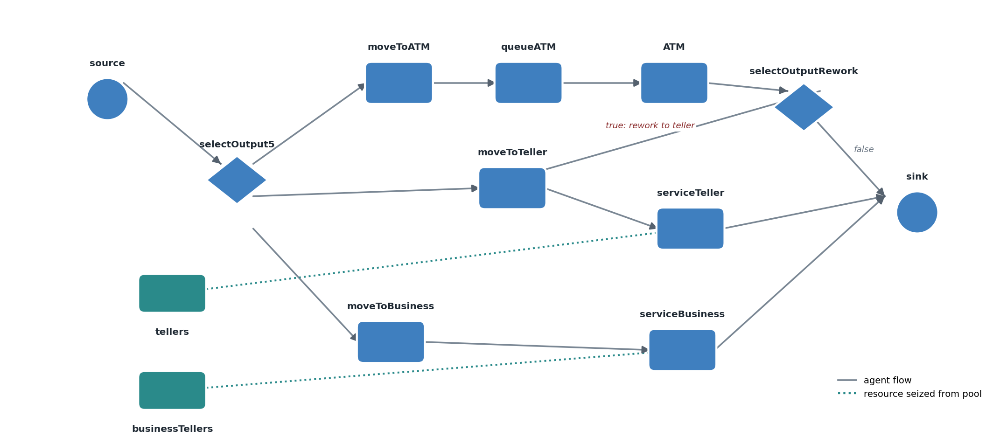
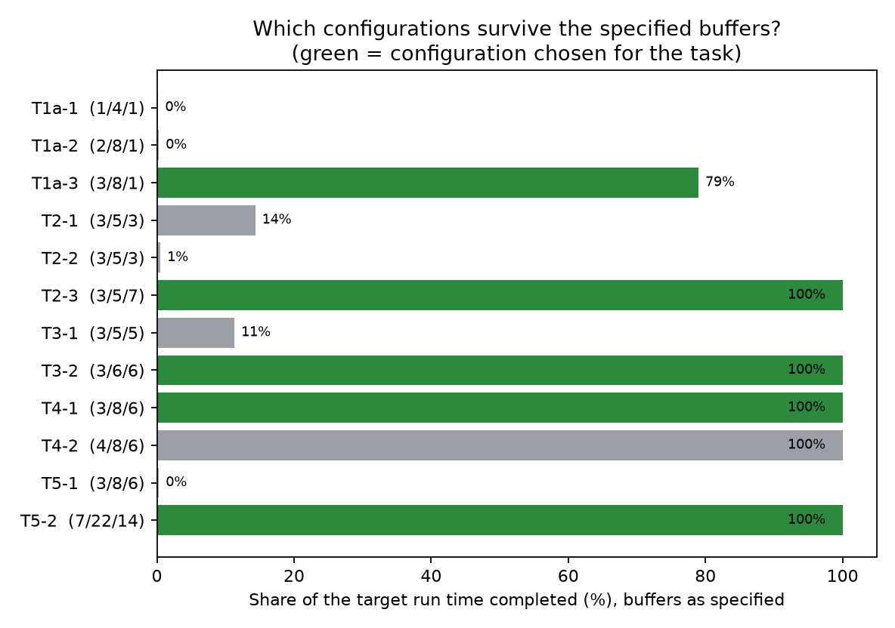
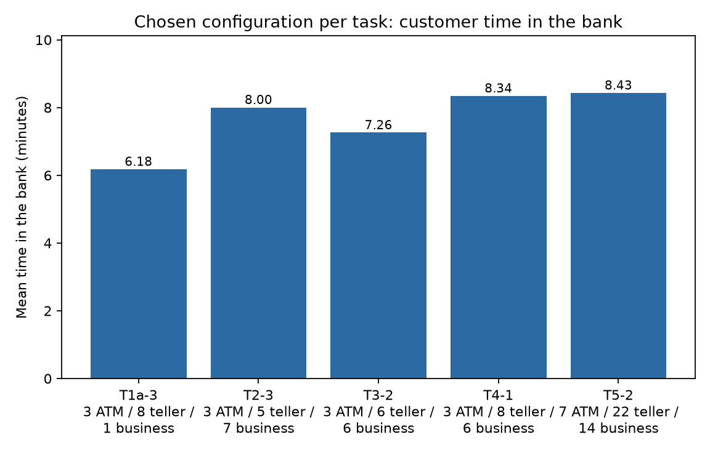
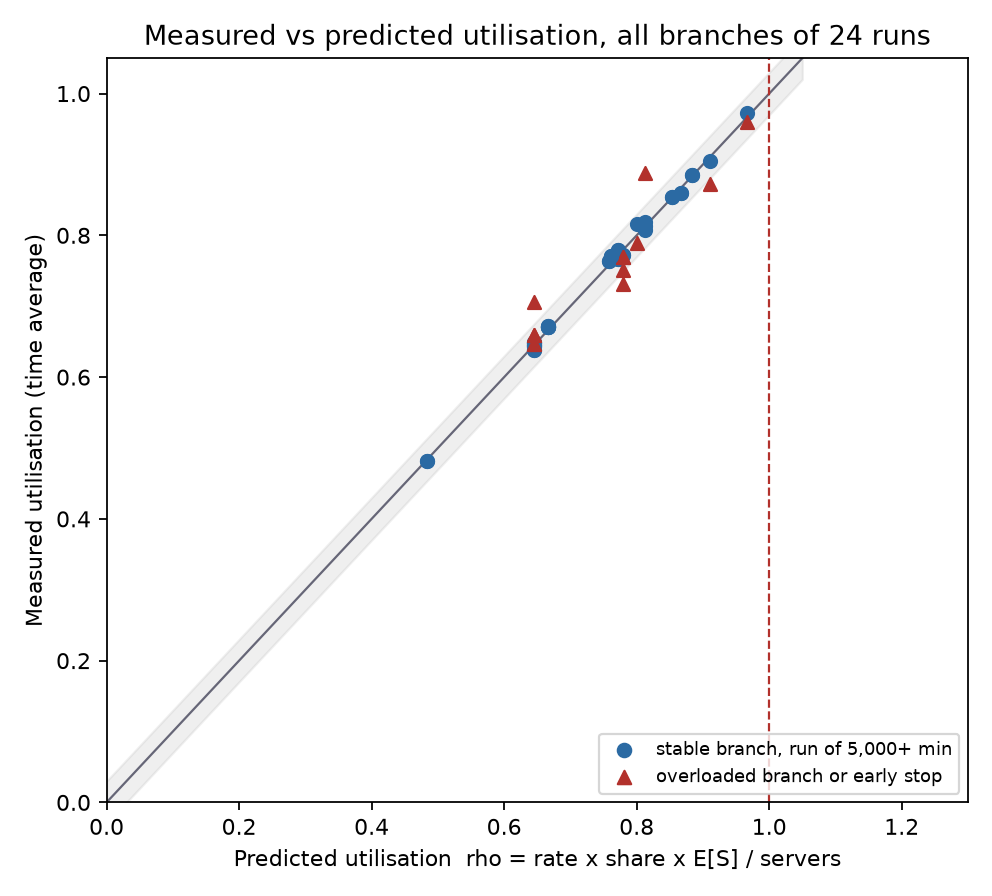

# Method and findings

Full write-up of the model, the sizing method and what the 24 AnyLogic runs show. Every number
below is a row of `data/bank-runs.csv` or is recomputed from it by `scripts/analyze_runs.py`
and asserted in `tests/test_results.py`.

## 1. The question

A bank branch has ATMs, ordinary tellers and business tellers. After a successful campaign more
customers arrive. **How many of each resource keep the branch working (short queues, staff neither
idle nor overloaded) in each demand scenario?** The same question is asked five ways:

| Task | Change to the branch |
|---|---|
| 1a | The class configuration (1 ATM, 4 tellers, 1 business teller) at 2 customers/min, split 50/50 between ATM and teller |
| 2 | Business customers join: split 50/30/20 (ATM / teller / business), business tellers given as 3 |
| 3 | The split changes to 50/35/15 |
| 4 | 25% of ATM users cannot finish at the machine and then join the teller queue (rework) |
| 5 | The arrival rate fluctuates: interarrival time is `exponential(triangular(2.5, 5.5, 12.5))` |

## 2. The model

A source feeds a probabilistic three-way split. The ATM branch is a Delay block whose capacity is
the number of machines; ordinary and business tellers are Service blocks that seize units from two
resource pools. After the ATM, a conditional split (`randomTrue(pRework)`) sends rework customers to
the teller queue. All branches end in one sink.

The model has eleven parameters on `Main` (`pRate`, the three routing shares, `pRework`, the three
resource counts, the two queue capacities and a fluctuation switch). No block holds a literal, so
the five tasks run on **one identical model** and differ only in parameter values.

One property shapes the results: the walking blocks have no capacity of their own, so a full waiting
area cannot hold a customer, and **a buffer overflow raises an exception and stops the whole run**
instead of degrading gracefully.

## 3. Method

**Offered load first.** Before simulating, each branch gets the number of servers it needs to be
exactly saturated, `rho = arrival rate x routing share x mean service time / servers`:

| Service | Distribution (minutes) | Mean |
|---|---|---:|
| ATM | triangular(0.8, 1.5, 3.5) | 1.93 |
| Ordinary teller | triangular(2.5, 6, 11) | 6.50 |
| Business teller | triangular(6, 12, 22) | 13.33 |

At 2 customers/min the floors are 1.93 ATMs, and: Task 2: 3.90 tellers and 5.33 business tellers;
Task 3: 4.55 tellers and 4.00 business tellers. Rework applies to the ATM branch's *arrivals*: in
Task 4 the teller branch gets 0.35 x 2 + 0.25 x (0.5 x 2) = 0.95 customers/min, an offered load of 6.175.

**Selection.** The reported configurations were selected for additional capacity headroom,
with measured utilisations around 64-89%. They are choices from the configurations tested,
not proven minimum staffing levels. For example, at a 90% utilisation ceiling, the load calculation
permits 3/5/6 for Task 2, 3/6/5 for Task 3 and 3/7/5 for Task 4, but those combinations were not run.
Load below capacity is necessary for stability; finite queues and a service target require further checks.

**Runs.** 12 configurations, each run twice: with the buffer sizes specified in the assignment
(15 for the ATM queue, 20 for the teller queues; 40/40 in Task 5), and with all buffers raised to
5,000 to expose steady-state behaviour. Fixed seed 1, virtual time, 20,000 minutes (7,000 in Task 5):
roughly 40,000 completions in a full-length stable run; overloaded runs may stop much earlier. **Each configuration is a single replication, so there are no
confidence intervals** and small differences should not be over-interpreted.

## 4. Findings

- **The class configuration fails structurally, not marginally.** With 1 ATM and 4 tellers the
  branch halts at 38.6 minutes, before 40 customers have been served. The offered-load calculation
  predicts this without any simulation.
- **Under-capacity plus a finite buffer is a stop, not a slowdown.** Three business tellers against a
  floor of 5.33 halt the branch at 101 minutes; raising the buffer to 500 only postpones it to
  2,867 minutes. With 5,000-place buffers the run completes but the business branch is pinned at
  100% utilisation, its mean queue is 1,773 customers and the longest customer journey is 8,907
  minutes (about six days). This is consistent with growing overload. **Seven business
  tellers** (77% utilisation) complete the target horizon in the tested configuration.
- **Sizing servers for mean load but buffers for typical load fails without warning.** The chosen
  Task 1 configuration (3 ATMs, 8 tellers; 64% / 81% utilisation, 6.2 minutes in the bank) is
  comfortable in steady state, yet halted once at 15,794 minutes when the 20-place teller queue
  filled. A buffer size is a design parameter in its own right.
- **Task 3:** 6 tellers and 6 business tellers (76% / 67%) give the shortest time in the bank of any
  completed configuration that includes business customers, 7.26 minutes. Five of each leaves the teller branch at 91% and halts the run.
- **Task 4:** 3 ATMs, 8 tellers and 6 business tellers give a measured teller utilisation of
  78.0% against 77.2% predicted, which confirms the 0.95 customers/min rework arithmetic. **A fourth
  ATM** lowers mean ATM waiting from 0.420 to 0.093 minutes (78%) and maximum ATM waiting
  from 7.253 to 3.302 minutes (54%). Total visit time falls by 3.8% (8.34 to 8.03 minutes).
  These are single-seed observations; costs and service targets determine whether it is worth adding.
- **Task 5:** the realised arrival rate is 6.18 customers/min, not the 6.83 mean of the triangular
  distribution. `exponential(x)` takes a rate, so the mean interarrival time is E[1/lambda], and by
  Jensen's inequality that is longer than 1/E[lambda]. The measured 43,187 completions in 7,000
  minutes (6.17/min) confirm it. Using 6.83 would overestimate offered load by about 10.6%, not necessarily staffing by that percentage. Keeping
  the Task 4 resources fails within 20 minutes; **7 ATMs, 22 tellers and 14 business tellers** run
  at 85% / 86% / 89% with 8.4 minutes in the bank.

## 5. Verification

Measured utilisation (time average from the engine) was compared with the offered-load prediction
for every branch. Across the **14 runs that reached 5,000+ minutes with a stable prediction**, the
largest gap is **1.6 percentage points**, and for the chosen configurations **0.9**. Two
runs with analytically stable loads stopped early (55 and 2,259 minutes) and have gaps of
7.5 and 3.7 points. Task 5 uses the independently derived renewal rate 6.181/min,
not completions divided by elapsed time; completions are not an arrival-rate estimate in overload.
The 5,000-minute cutoff is a screening rule, not proof of steady state.

## 6. Limits and a note on sizing rules

- **Single replication per configuration** at seed 1: exactly reproducible, no confidence interval.
- **Not run:** a hold-out comparison, other seeds, or costs. "Right-sized" means utilisation in a
  chosen band with short queues, not minimum cost.
- **Two reasonable sizing rules give different Task 4 answers.** The first report for this
  assignment sized for utilisation at or below 80% and recommended 3 ATMs, 8 tellers and 5 business
  tellers (business utilisation 80%). This study chose 6 business tellers (67%) for more headroom
  and measured it. The 24-run dataset does not compare those two staffing choices directly, so their waiting-time trade-off is unmeasured.
- **Evidence packaging.** An earlier submission of this work described the runs in words and tables
  only. Here every number is tied to a data row, and the figures are generated from the data.
